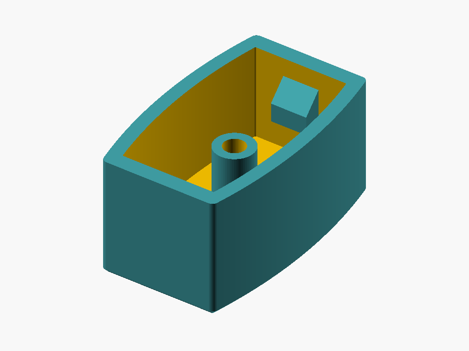
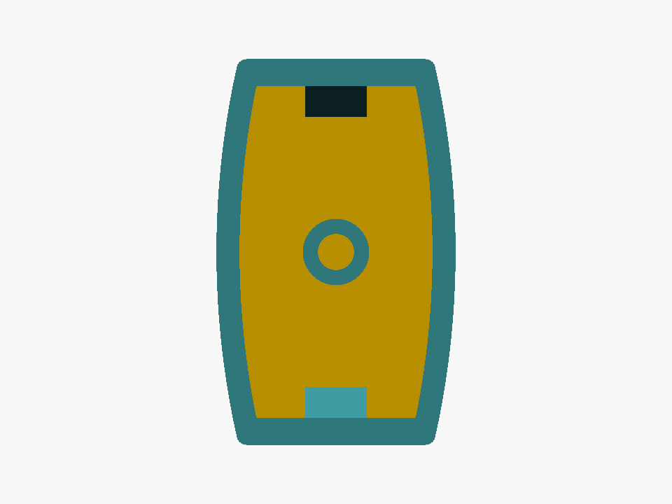
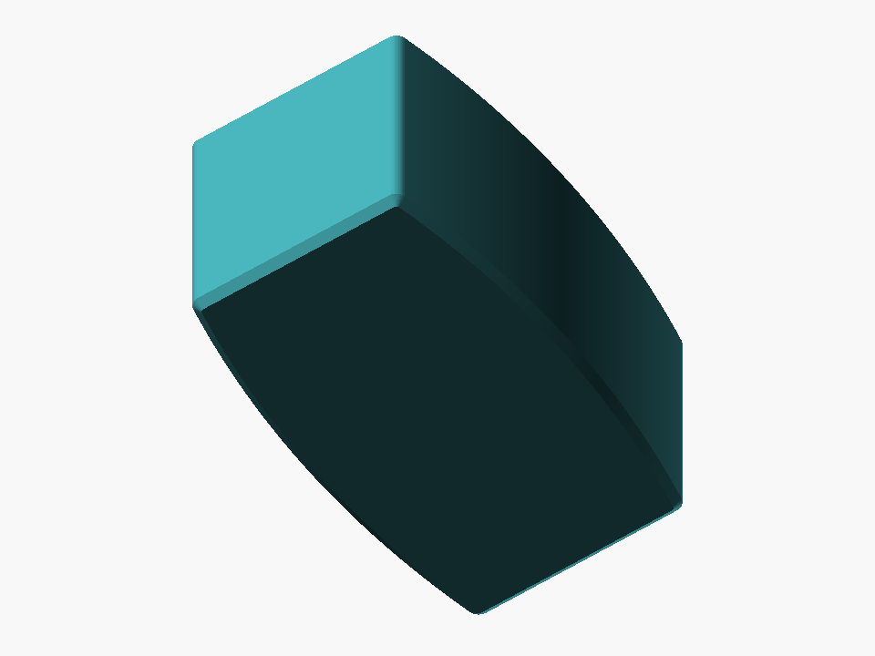

# Miniblind Bottom-Rail End Cap

Parametric OpenSCAD replacement of the protective plastic cap on a miniblind bottom rail. The originals fracture when the blind contacts a windowsill.

**Status: FINAL — v0.14 physically fit-accepted (October 24, 2026).** The complete printed end cap **fits successfully**, as confirmed by the user after the last retention-tab placement adjustment. Keep this design as the known-good baseline. The short-end trapezoidal tabs are 4 mm wide × 5 mm tall × 2 mm maximum inward projection, horizontally centered and positioned with their top edges **2 mm below the open lip**. The curved interior midpoint remains **12.5 mm**, with concentric circular sidewalls (outside R55 mm, inside R53.5 mm). Overall outside envelope **25 × 15.5 × 12.7 mm**; opening length **21.5 mm**.

## Finished design — OpenSCAD renders

These images are generated directly from the **final parametric OpenSCAD model** using the repository's GitHub Actions workflow, not conceptual illustrations or photographs:

| Open interior and retention tabs | Direct opening view | Closed exterior face |
|:---:|:---:|:---:|
|  |  |  |

The six original caliper photographs are not committed to this repository. These renders document the completed CAD geometry; the physical fit result is based on the user's printed test.

## Project

- [Editable OpenSCAD model](src/end-cap.scad): defaults to complete end cap; switch `mode` to `fit_gauge` for a 5 mm profile test.
- [Measurement notes](docs/MEASUREMENT_NOTES.md): caliper-photo interpretations and outstanding unknowns.
- [Automated OpenSCAD build](.github/workflows/build-exports.yml): regenerates STL and mesh-only 3MF exports and the three rendered model PNGs, commits them to `main`, and publishes printable mesh artifacts.
- [Additional measurements](reference/README.md): reserved for the metal rail's cross-section and retention details.

The six original reference photographs remain in the initial locally downloadable project ZIP and are **not currently stored in this remote repository**. The editable OpenSCAD source is authoritative; STL/3MF exports are regenerated and committed by the source-change build.

## Initial parameters (mm)

| Feature | Starting value | Basis |
|---|---:|---|
| Exterior length `length` | 25.0 | Kept for end-wall strength |
| Exterior maximum width `outer_width_center` | 15.5 | Fixed center-envelope target |
| Constant side arc `outer_side_radius` | 55.0 | Increased to open width toward each end |
| Exterior end width | ~12.62 | Wider ends from increased circular radius; max width still 15.5 |
| `cap_depth` | 12.7 | Caliper photo |
| `corner_radius` | 0.65 | Visual estimate |
| Inside `inside_length` | 21.5 | Latest physical measurement |
| `inside_center_width` | 12.5 | Center-opening constraint for this trial |
| `inside_side_radius` | 53.5 | Concentric interior arc derived from new 1.50 mm wall |
| `side_wall` | 1.50 | Constant radial thickness of each curved long wall |
| Predicted interior end width | ~10.32 | Circle-derived prediction; not a separate constraint |
| Predicted interior 5 mm width | ~11.88 | Circle-derived prediction; not a separate constraint |
| `inside_corner_radius` | 0.15 | Small corner fillets; curved sides remain circular |
| Impact `face` | 2.6 | Design choice |
| `boss_diameter` | 4.3 | Unverified estimate |
| `bore_diameter` | 2.35 | Unverified estimate |

The complete end cap uses the same circle centers for its inner and outer long sides. Setting only the interior center width gives the inner circle radius and a constant 1.50 mm radial separation. Corner transitions and end walls are separately rounded, and the outer shape remains 25 × 15.5 mm. The finished model includes the reinforced closed face and optional hollow center boss. Geometry-render and mesh checks passed locally. The complete printed cap has now been confirmed to fit, including the updated retention tabs.

## Retention stubs (full cap only)

The full cap has two symmetric raised trapezoid-profile grips at the center of the inner **short-end walls**, Y = ±10.75 mm, not on the long curved sidewalls. A gentle `/---\\` side profile allows the rail to meet the stub gradually when the cap is pushed on. Parameters in `src/end-cap.scad`:

- `include_retention_stubs = true` — enable/disable both stubs (full cap only).
- `stub_width = 4.0` mm — across each end wall (X).
- `stub_length = 5.0` mm — down the face of each end wall along Z toward the cap's closed end.
- `stub_projection = 2.0` mm — peak projection into the rail space (Y).
- `stub_lead_ramp = 2.0` mm, `stub_trailing_ramp = 1.0` mm — the leading slope runs from the opening side, followed by a 2 mm flat plateau and a 1 mm trailing slope.
- `stub_embed = 0.20` mm — hidden overlap into each end wall to form a solid joint, *not* an extra protrusion.
- `stub_top_clearance = 2.0` mm — fixed gap from the open lip to the top of each retention stub.

Each stub is positioned **2.00 mm below the open lip**, using `stub_top_clearance = 2.0` mm. Because the opening is at Z=12.70 mm and each stub is 5.00 mm long, the stubs now occupy **Z=5.70–10.70 mm** (center Z=8.20 mm), precisely **0.55 mm higher** than v0.13. Both remain horizontally centered at X=0; their shape and Y position are unchanged. Two opposed 2 mm projections reduce the free Y opening **locally** by up to 4 mm. The user confirmed the printed final cap fits; do not force copies if print settings or rail dimensions differ. The `fit_gauge` continues to check only the originally fitted cavity silhouette and does not include stubs.

## Open / print

Open `src/end-cap.scad` in OpenSCAD, F6, and export STL. Default `mode = "final"` shows the full finished cap. For a quick profile-only test set `mode = "fit_gauge"`, export the gauge, then **restore `final`**.

On the Bambu P1S, an initial PLA test can use 0.4 mm nozzle, 0.20 mm layers, 3–4 walls and no supports, with the closed face down. Verify the slice first. The gauge only tests cross-sectional clearance: it does not validate insertion depth, retention, or central-boss interference. Try the gauge on the bare metal bottom rail before printing a whole replacement.

A PETG final part or bumper on the windowsill may improve impact survival, but that is not yet tested.

## Next measurements

The curved-profile gauge is physically fit-confirmed. Inspect the new trapezoidal retention stubs in the complete end cap before printing. Test the full cap gently for snap/retention; adjust only the stub dimensions if fit changes are needed. Report where it contacts or remains loose along the sidewalls. If the profile fits, measure/verify insertion depth and center-boss engagement on the complete cap. Keep source, documentation and generated exports aligned when adjusting parameters.

## Git / licensing

This repository's **main** branch records the accepted v0.14 design. The unchanged parametric source is the master; STL, 3MF, and OpenSCAD PNG preview exports are generated and committed by GitHub Actions. The fit-accepted source revision is [`49fb175`](https://github.com/lairdrt/miniblind-end-cap/commit/49fb17565e1882e281f49856c0465950582f5aa9). This commit is an immutable checkpoint; future refinements should branch from the known-good geometry rather than silently replacing it.

Original OpenSCAD source and text: GPL-3.0-or-later. See LICENSE.
